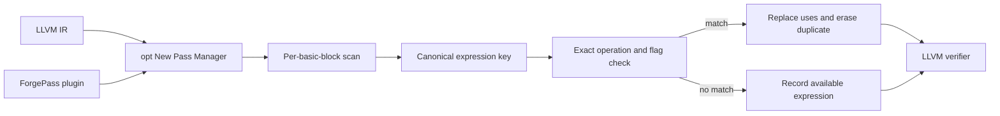

# Forge: LLVM CPU Optimization Toolkit

Forge is an out-of-tree LLVM New Pass Manager plugin that conservatively
eliminates redundant integer arithmetic inside a basic block. It is a compact,
auditable compiler-engineering project: the repository separates implemented
behavior, correctness evidence, and performance measurements.

> Validation status (2026-10-13): the plugin compiled with LLVM/Clang 18.1.3
> in the repository's Ubuntu 24.04 container. All four CTest groups passed,
> including 100 seeded generated verifier cases. A three-trial benchmark smoke
> run completed all six pipelines with matching outputs. This short smoke run
> is pipeline validation, not statistically meaningful performance evidence.
> GitHub Actions independently passed the LLVM 18 build and all tests.

## Transformation

```llvm
; before
%x = add i32 %a, %b
%y = add i32 %b, %a
%r = mul i32 %x, %y

; after
%x = add i32 %a, %b
%r = mul i32 %x, %x
```

Forge considers LLVM integer `BinaryOperator` instructions. A prior expression
is reused only when it occurs earlier in the same basic block, has the same
opcode, result type, operands, and semantic flags, and neither operand is a
literal `undef` or `poison`. Operands may be reversed only for an operation LLVM
marks commutative. The replacement therefore dominates every replaced use.

Bitwise `or` is excluded for cross-version safety because recent LLVM versions
can attach additional `disjoint` semantics to it.

Memory writes and calls do not kill entries because eligible expressions read
only immutable SSA operands and no memory. Forge does not perform cross-block
value numbering, floating-point CSE, load CSE, algebraic rewriting, or constant
folding.

### Why the narrow rule is safe

- SSA values do not change after definition.
- Earlier instructions in one basic block dominate later instructions.
- `isSameOperationAs` prevents reuse across different `nsw`, `nuw`, or `exact`
  semantics.
- Direct `undef` operands are rejected because each use may choose a different
  value. Explicit poison is rejected to keep the policy easy to audit.
- Only side-effect-free LLVM integer binary operators are candidates.

This is testing evidence and a design argument, not a formal proof.

## Architecture



## Prerequisites and build

Use one consistent LLVM installation (LLVM 18 is used in CI):

```bash
cmake -S . -B build -G Ninja \
  -DLLVM_DIR="$(llvm-config --cmakedir)" \
  -DCMAKE_BUILD_TYPE=Release
cmake --build build
ctest --test-dir build --output-on-failure
```

Run the pass manually (the shared-library suffix is platform-dependent):

```bash
opt -load-pass-plugin ./build/lib/ForgePass.so \
  -passes='forge-redundant-expr-elim,verify' -S input.ll -o output.ll
```

## Validation

The CTest suite runs:

- FileCheck cases for repetition, commutativity, constants, branches, loops,
  signed/unsigned flags, literal undef, and intervening effects;
- LLVM's verifier after every transformation; and
- 100 deterministic generated IR cases with seed `20261013`.

The generated cases exercise construction and verifier validity. They are not a
formal equivalence proof. Executable equivalence is also checked by the
benchmark harness, which refuses to report timings when outputs differ.

## Benchmarking

After building, run:

```bash
python3 benchmark/run.py --plugin ./build/lib/ForgePass.so
```

The harness builds paired `O0`, `O2`, and `O3` pipelines with and without Forge,
runs nine trials by default, checks identical output, and records raw timings,
median runtime, optimizer time, textual IR instruction count, and binary size in
`benchmark/results/latest.json`. Results are intentionally absent until they
are measured on real hardware.

LLVM's standard optimization pipelines already contain stronger mechanisms
such as EarlyCSE and GVN. Forge is therefore expected to help mainly in a
minimal pipeline; at `-O2`/`-O3`, neutral results are the likely honest outcome.

## Repository map

- `lib/ForgePass.cpp` — pass implementation and plugin registration
- `test/ir/` — FileCheck regression tests
- `test/randomized_ir.py` — reproducible generated verifier cases
- `benchmark/` — CPU workload and measurement harness
- `.github/workflows/ci.yml` — LLVM 18 build and test job

## Limitations and future work

Forge is local to a basic block and intentionally does not reason about memory,
dominance across blocks, floating-point flags, or expression profitability.
Future work should start with Alive2-checked transformations and differential
testing before broadening scope. A useful next engineering step is comparing
compile-time and hit-rate data directly with LLVM EarlyCSE rather than adding
more transformations speculatively.

## Resume bullet (provisional)

Built an out-of-tree C++17 LLVM New Pass Manager plugin for conservative
same-basic-block integer expression elimination, with flag-aware matching,
FileCheck/verifier regressions, deterministic generated tests, reproducible
benchmarks, an Ubuntu validation container, and LLVM 18 CI.

## License

MIT
