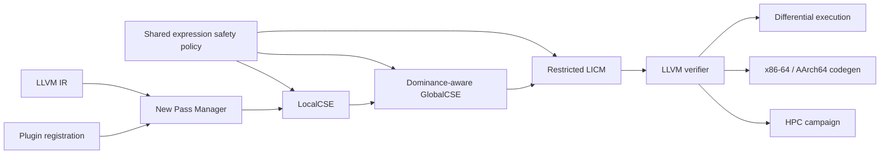

# Forge: LLVM CPU Optimization Toolkit

Forge is a modular, out-of-tree LLVM 18 New Pass Manager toolkit for studying
conservative CPU middle-end transformations and their performance consequences.
It implements three distinct passes:

| Pipeline name | Scope | Safety boundary |
|---|---|---|
| `forge-local-cse` | One basic block | Exact integer expressions and flags |
| `forge-global-cse` | Dominated CFG regions | Scoped dominator-tree availability |
| `forge-licm` | Innermost loops | Preheader + invariant operands + safe speculation |

The older `forge-redundant-expr-elim` spelling remains an alias for LocalCSE.
Forge is intentionally narrower than LLVM EarlyCSE, GVN, and LICM and does not
claim to replace them.

## Current evidence

Forge v3 is built with LLVM/Clang 18.1.3 in Ubuntu 24.04. The current local
feature branch has 13 passing CTest groups, 2 explicit dependency skips, and 0
failures:

- pass-specific FileCheck and verifier regressions;
- positive and prohibited dominance/loop transformations;
- 100 generated verifier cases and 250 mutation cases with seed `20261013`;
- executable differential comparison over boundary and deterministic inputs;
- structured diagnostics and an auditable experiment-registry smoke test; and
- static x86-64/AArch64 backend generation.

The 21-round campaign of record uses randomized-interleaved schedule order and
matching correctness digests. It finds mixed Forge results and no generated-code
change when Forge follows O2/O3. Alive2 and the local sanitizer runtime remain
explicitly unavailable. See the [v3 evidence report](docs/FORGE_V3_REPORT.md).

## Architecture



The shared policy in `lib/Expression.cpp` rejects floating point, memory
operations, literal poison/undef, constants containing poison/undef, and
bitwise `or` (whose `disjoint` semantics vary across LLVM versions). It compares
`nuw`, `nsw`, and `exact` explicitly.

GlobalCSE walks the dominator tree with scoped available-expression stacks. It
does not implement PHI translation, partial redundancy elimination, or memory
value numbering. Forge LICM moves only eligible integer binary operations from
innermost loops when a preheader exists and LLVM reports speculation safe.

See [correctness](docs/CORRECTNESS.md), [experiments](docs/EXPERIMENTS.md),
[performance](docs/PERFORMANCE_REPORT.md), and the
[v3 evidence report](docs/FORGE_V3_REPORT.md).

## Build and test

```bash
cmake -S . -B build -G Ninja \
  -DLLVM_DIR="$(llvm-config --cmakedir)" \
  -DCMAKE_CXX_COMPILER=clang++ \
  -DCMAKE_BUILD_TYPE=Release
cmake --build build
ctest --test-dir build --output-on-failure
```

The repository also supplies `CMakePresets.json` for the Ubuntu LLVM 18
container and `Dockerfile.ci` for reproducibility.

```bash
opt -load-pass-plugin ./build/lib/ForgePass.so \
  -passes='forge-local-cse,forge-global-cse,forge-licm,verify' \
  -S input.ll -o output.ll

./build/tools/forge-analyze/forge-analyze input.ll
```

`forge-analyze` emits JSON containing function, block, instruction, eligible
expression, and local opportunity counts plus the configured pipeline.

## Static backend analysis

```bash
python3 analysis/analyze_backends.py \
  --clang clang-18 --llvm-mca /usr/lib/llvm-18/bin/llvm-mca \
  --commit "$(git rev-parse HEAD)"
```

This produces ignored raw artifacts and a manifest under `analysis/results/`.
It never executes AArch64 output on an x86-64 host. See
[AARCH64.md](docs/AARCH64.md) for the evidence boundary.

## HPC benchmark campaign

```bash
python3 experiments/run_experiments.py \
  --clang clang-18 --opt opt \
  --plugin ./build/lib/ForgePass.so \
  --commit "$(git rev-parse HEAD)" \
  --size 5000000 --trials 21
```

The campaign exercises matrix multiplication, reduction, dot product, stencil,
strided traversal, repeated arithmetic, and a loop recurrence. It records raw
trial timings, randomized execution order, optimizer time, IR and assembly
counts, artifact hashes, binary size, toolchain and host metadata, pass
pipelines, and validation digests for eight schedules. Benchmark output is
rejected if any schedule's digest differs. CI remains a correctness and build
check, not a performance-comparison environment.

## Repository map

- `include/forge/` — pass and shared expression contracts
- `lib/` — plugin registration and three pass implementations
- `tools/forge-analyze/` — native LLVM IR reporting CLI
- `test/` — structural, generated, and differential validation
- `analysis/` — x86-64/AArch64 assembly and `llvm-mca` workflow
- `benchmark/` — HPC kernels and reproducible campaign scripts
- `docs/` — audit, correctness, architecture, workflow, and interview material

## Known limitations

- No memory expression elimination, floating-point transformations, PHI
  translation, PRE, or complete GVN.
- LICM neither creates preheaders nor moves memory operations.
- No general-purpose loop unroller; adding one before stronger correctness
  evidence would broaden risk without deepening the core project.
- Alive2 integration is present but `alive-tv` is unavailable locally, so no
  formal-refinement result is claimed.
- The cached local container lacks sanitizer runtimes; that test is skipped
  locally rather than reported as passing.
- No native AArch64 or NVIDIA Grace measurements have been made.

## Resume bullet

Developed a modular C++17 LLVM 18 optimization toolkit with flag-aware local
CSE, dominator-tree global CSE, and speculation-checked integer LICM; added
FileCheck/verifier regressions, seeded and differential execution tests,
AArch64/Neoverse static analysis, a seven-kernel HPC campaign, a native IR
analysis CLI, container builds, and CI-ready reproducibility.

## License

MIT
